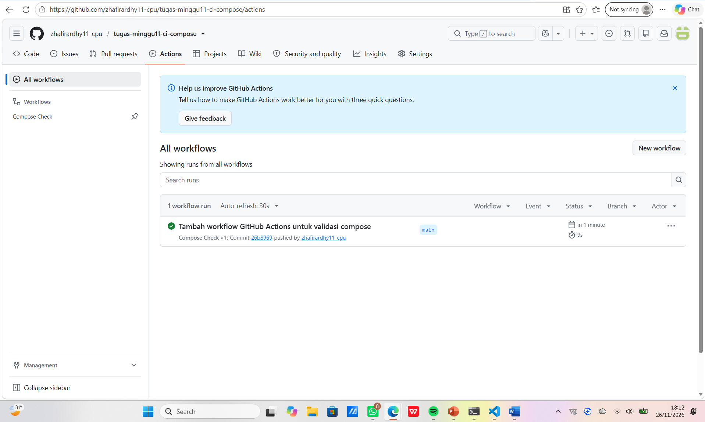
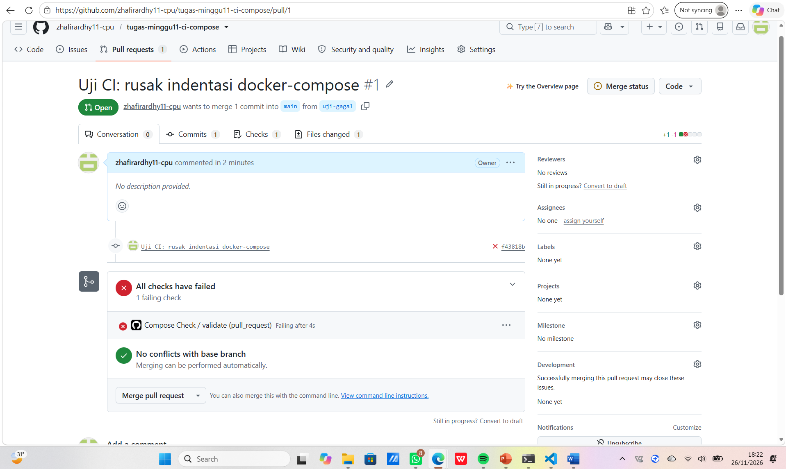
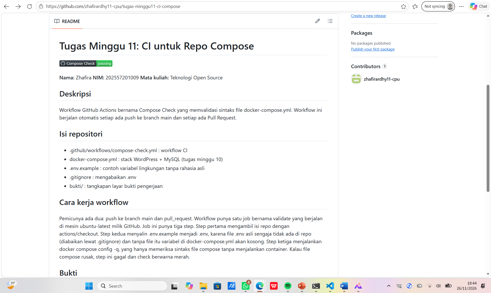

# Tugas Minggu 11: CI untuk Repo Compose

**Nama:** Zhafira
**NIM:** 202557201009
**Mata kuliah:** Teknologi Open Source

## Deskripsi
Workflow GitHub Actions bernama Compose Check yang memvalidasi sintaks file docker-compose.yml. Workflow ini berjalan otomatis setiap ada push ke branch main dan setiap ada Pull Request.

## Isi repositori
- .github/workflows/compose-check.yml : workflow CI
- docker-compose.yml : stack WordPress + MySQL (tugas minggu 10)
- .env.example : contoh variabel lingkungan tanpa rahasia asli
- .gitignore : mengabaikan .env
- bukti/ : tangkapan layar bukti pengerjaan

## Cara kerja workflow
Pemicunya ada dua: push ke branch main dan pull_request. Workflow punya satu job bernama validate yang berjalan di mesin ubuntu-latest milik GitHub. Job ini punya tiga step. Step pertama mengambil isi repo dengan actions/checkout. Step kedua menyalin .env.example menjadi .env, karena file .env asli sengaja tidak ada di repo (diabaikan lewat .gitignore) dan tanpa file itu variabel di docker-compose.yml akan kosong. Step ketiga menjalankan docker compose config -q, yang hanya memeriksa sintaks file compose tanpa menjalankan container. Kalau file compose rusak, step ini gagal dan check berwarna merah.

## Bukti
1. Run hijau di tab Actions
   
2. Pull Request dengan check gagal (merah)
   
3. Badge status di README
   

Tautan Pull Request (sudah hijau dan di-merge): https://github.com/zhafirardhy11-cpu/tugas-minggu11-ci-compose/pull/1

## Kendala dan cara mengatasinya
1. Push lewat HTTPS tidak menerima password akun, jadi aku membuat Personal Access Token. Agar file di folder .github/workflows bisa di-push, token harus dicentang scope workflow selain repo.
2. Pull Request uji-gagal sengaja dibuat merah dengan menghapus satu spasi di depan baris image pada docker-compose.yml. Check validate gagal karena indentasi YAML-nya rusak. Setelah indentasi aku kembalikan dan di-push ke branch yang sama, check berubah hijau lalu PR di-merge.

## Refleksi singkat
Dengan CI, kesalahan di file compose ketahuan otomatis sebelum digabung ke main, jadi tidak perlu menjalankan pengecekan manual setiap kali ada perubahan. Pengalaman membuat PR yang sengaja gagal membuatku paham bahwa check merah itu membantu menahan file yang rusak.
